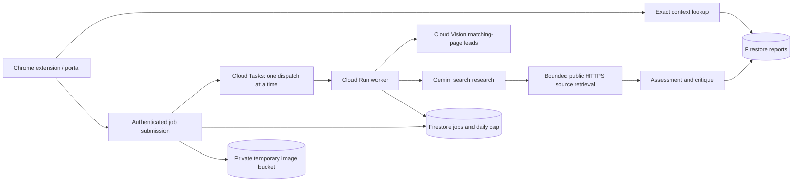
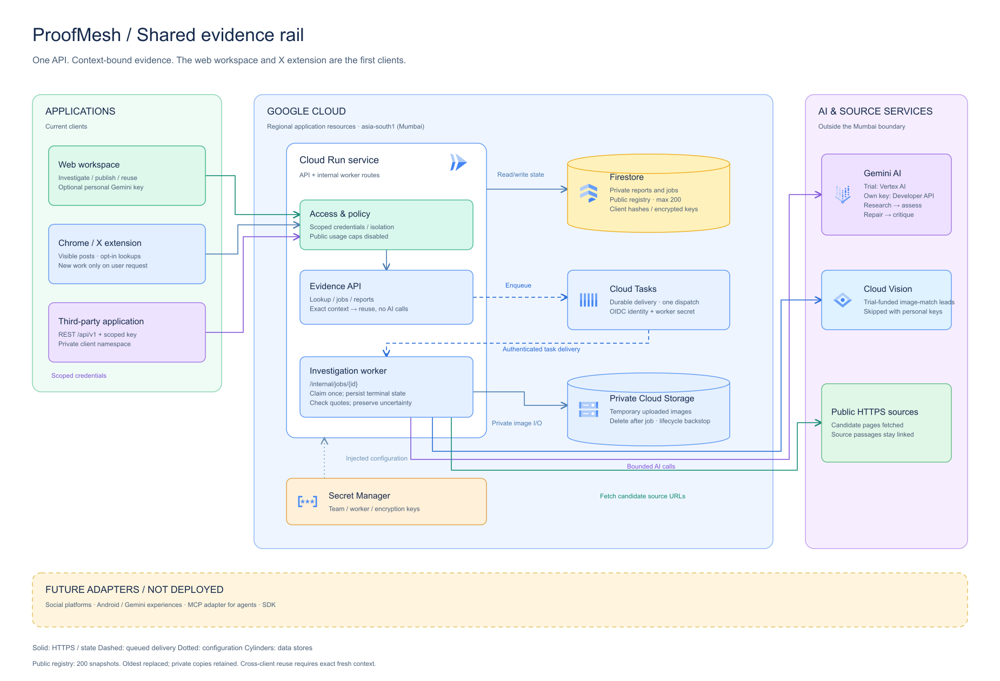

# ProofMesh evidence rail architecture

Exact reuse requires the normalized claim, canonical decoded image identity, corpus, UTC reference date, supplied publication timestamp, evidence-policy version and fresh report expiry. Related dHash candidates are navigation leads; they carry no verdict for the new caption. Exact lookups do not call Vision or Gemini.

The same Gemini model performs research, assessment and critique. This is a bounded workflow, not a claim of independent autonomous agents or independent fact verification. Fetched passages must support non-unresolved findings. A page timestamp is not an image capture timestamp. Origin stays unknown.

Jobs and daily admission counts are transactional. Cloud Tasks retries delivery, while a persistent worker claim prevents duplicate inference. Terminal or interrupted model work is not automatically repeated. A user can explicitly retry a failed job once; each attempt consumes admission budget. Uploaded images are stored privately, deleted after work, and subject to a one-day lifecycle backstop.

The rail consists of the lookup API, investigation jobs, report contract and shared registry. The web workspace and X extension are clients of those APIs. Public access includes the bounded shared registry, synthetic demo and frozen, deliberately published evaluation examples. Team reports require trusted credentials. Ordinary visitors receive scoped guest cookies, and developer keys receive private client namespaces. The hosted legacy reviewer credential is disabled. The internal worker requires a different secret and receives a Cloud Tasks OIDC token. Runtime credentials come from the attached service account; no service-account keys are deployed.

Cloud Run, Firestore, task queue and storage use Mumbai (`asia-south1`). Gemini uses `global`; this build makes no India-only data residency claim. Zero minimum instances and one maximum instance bound serving capacity but do not impose an absolute dollar cap.

The API is a prototype contract, not yet a stable versioned integration product. Social-platform clients, Android/Gemini experiences, SDKs and an MCP adapter are roadmap options described in `RAIL.md`, not current integrations.

## Current access architecture (v0.5)

[Editable draw.io source](diagrams/proofmesh-architecture.drawio) · [SVG](diagrams/proofmesh-architecture.svg) · [PNG](diagrams/proofmesh-architecture.png)

The normal browser flow creates a limited guest session on demand. Developer keys use the same per-client namespace and admission policy. Team credentials for Harshwardhan, Chennika and authorized Codex tests bypass application request/daily limits; financial guards still apply. The optional legacy reviewer-code implementation is disabled on the hosted service; the main app uses automatic visitor access. Selected public examples and explicitly shared eligible registry snapshots are public. Other client reports remain private.

The diagram uses native editable component boundaries, orthogonal connectors and cylinders for Firestore and image storage. Service logos are embedded, so the draw.io file has no external image dependency. Icons come from the [official Google Cloud icon library](https://cloud.google.com/icons), using its legacy downloadable collection. Logos identify services and imply no endorsement. The SVG/PNG preview is generated from the same layout; no claim of a native diagrams.net export is made.

Personal-key investigations take a second provider branch: the same research/assessment/citation-repair/critique pipeline calls Gemini Developer API with the caller's key, without loading Vertex ADC or invoking the project-funded Cloud Vision lookup. A private job field stores only short-lived Fernet ciphertext, excluded from public job responses; Secret Manager supplies the encryption key. Worker terminal paths clear it. Project-trial funds and per-client quotas are separate from that branch. No shared investigation-count cap remains.

The v0.7 public registry is a separate bounded set of 200 snapshots. Private client namespaces remain intact; a publish step creates an allowlisted public snapshot with a global context ID and internal ownership metadata. A single transactional index enforces deduplication and retention in Firestore; SQLite uses an immediate write transaction. Matching checks private reports and the public registry, requiring exact fresh context. Public reads, explicit publication and authorized withdrawal are exposed through the versioned API. See REGISTRY.md for exclusions and limits.
