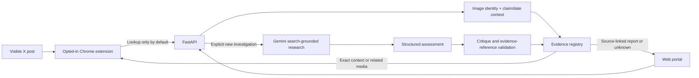

# Architecture

## First-slice invariants

1. A verdict belongs to a claim plus media plus reference context, never merely an image hash.
2. Perceptual similarity retrieves candidates; exact context is required for automatic reuse.
3. Demo records are isolated from live records.
4. Missing evidence and missing provenance remain unknown.
5. Model text cannot create arbitrary source URLs: displayed live evidence URLs come from provider grounding metadata.
6. Search-grounded model summaries are labeled as summaries. We do not claim independent page retrieval.
7. New model investigations are explicit; scrolling only performs registry lookups.
8. Server-side credentials stay on the server. Client API tokens are separate from cloud credentials.

## Data and privacy

The local registry stores submitted claims, media hashes, findings and cited evidence, not raw uploaded image files. Images are decoded in memory. In live mode, metadata is removed before resized image pixels are sent to Vertex AI. Do not submit private or employer material during public demonstrations.

The development extension sends the visible caption and first supported image to localhost after opt-in. It has no cookie/history permission. Direct-message URLs are excluded. The next improvement is computing/caching fingerprints locally and sending only lookup identifiers for automatic matching.

SQLite is durable for local development; Cloud Run must use Firestore. The server refuses a Cloud Run configuration without Firestore and an API token. Firestore persistence, indexes, identity and access rules need a real project test before deployment claims.

## Investigation quality

The three stages are bounded model calls, not independently trained experts or separate external investigators. The critique pass can downgrade an assessment, but agreement between passes does not prove truth. The UI exposes uncertainty and evidence to support human inspection.

The starter does not establish an image's original publication date/location, AI origin or editing history. Search can surface candidate evidence; future reverse-image and provenance integrations must preserve those limits.

## Scaling beyond the starter

Replace capped registry scans with indexed context lookup and perceptual-neighbor retrieval. Add durable jobs, distributed quotas, report revision/retraction, claim context beyond a UTC date, source archiving/refresh, user identity and moderated contributions. Semantic matching should propose candidate claims for contextual review rather than transfer labels automatically.

