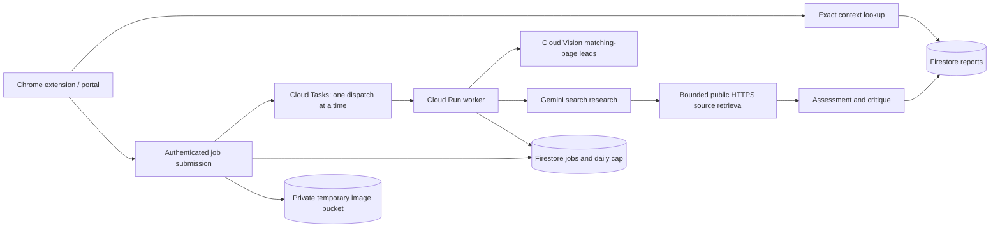

# ProofMesh architecture

Exact reuse requires the normalized claim, canonical decoded image identity, corpus, UTC reference date and fresh report expiry. Related dHash candidates are navigation leads; they carry no verdict for the new caption. Exact lookups do not call Vision or Gemini.

The same Gemini model performs research, assessment and critique. This is a bounded workflow, not a claim of independent autonomous agents or independent fact verification. Fetched passages must support non-unresolved findings. A page timestamp is not an image capture timestamp. Origin stays unknown.

Jobs and daily admission counts are transactional. Cloud Tasks retries delivery, while a persistent worker claim prevents duplicate inference. Terminal or interrupted model work is not automatically repeated. A user can explicitly retry a failed job once; each attempt consumes admission budget. Uploaded images are stored privately, deleted after work, and subject to a one-day lifecycle backstop.

Public access consists of the synthetic demo and frozen, deliberately published evaluation examples. Live reports and new jobs require the team API token. The internal worker requires a different secret and receives a Cloud Tasks OIDC token. Runtime credentials come from the attached service account; no service-account keys are deployed.

Cloud Run, Firestore, task queue and storage use Mumbai (`asia-south1`). Gemini uses `global`; this build makes no India-only data residency claim. Zero minimum instances and one maximum instance bound serving capacity but do not impose an absolute dollar cap.
